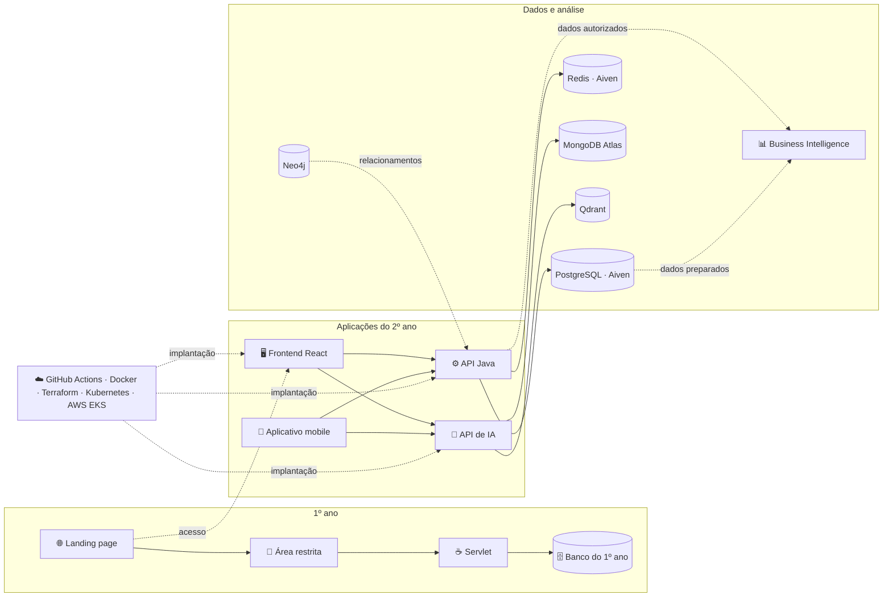

<div align="center">

<h1>❄️ Skadi</h1>

### Monitoramento inteligente para proteger alimentos, operações e resultados


[A solução](#-a-solução) •
[Como funciona](#-como-funciona) •
[Arquitetura](#-arquitetura) •
[Tecnologias](#-tecnologias) •
[Repositórios](#-repositórios) •
[Equipe](#-responsabilidades-da-equipe) •
[Contribuição](#-fluxo-de-trabalho)

</div>

---

## 💡 A solução

O **Skadi** monitora a temperatura de câmaras frigoríficas para apoiar a conservação de carnes, frangos e outros alimentos perecíveis. O sistema registra as medições dos termômetros, identifica temperaturas fora dos limites definidos, gera alertas e acompanha o atendimento das ocorrências.

<div align="center">

| 🌡️ | ➜ | ⚙️ | ➜ | 🚨 | ➜ | ✅ |
|:---:|:---:|:---:|:---:|:---:|:---:|:---:|
| **Leitura** da temperatura | | **Validação** pela API | | **Alerta** e notificação | | **Atendimento** registrado |

</div>

> Detectar uma variação no momento certo ajuda a preservar os alimentos, reduzir prejuízos e manter um histórico confiável da operação.

Ao reduzir o risco de deterioração dos alimentos e os prejuízos causados por falhas de refrigeração, o projeto contribui para o [**Objetivo de Desenvolvimento Sustentável 12 — Consumo e Produção Responsáveis**](https://brasil.un.org/pt-br/sdgs/12), especialmente para a **meta 12.3**, que busca reduzir o desperdício e as perdas de alimentos ao longo das cadeias de produção e abastecimento.

## 🔄 Como funciona

1. Um termômetro envia uma leitura de temperatura associada a uma câmara frigorífica.
2. A API valida e registra a leitura.
3. O sistema compara a temperatura com os limites mínimo e máximo configurados para a câmara.
4. Quando a medição está fora do intervalo permitido, o sistema cria ou atualiza um alerta, evitando ocorrências duplicadas.
5. O evento entra em uma fila no Redis para processamento e envio de notificações.
6. O operador responsável reconhece o alerta, registra o atendimento e informa a justificativa e a ação realizada.
7. Gestores e administradores acompanham a situação atual, o histórico de temperaturas, os alertas e os relatórios.
8. As aplicações web, mobile e de inteligência artificial consomem as APIs conforme o perfil e o escopo de acesso do usuário.
9. A frente de BI transforma os dados autorizados em indicadores e painéis para apoiar o acompanhamento operacional e a tomada de decisão.

Os perfis previstos são:

- **Super ADM:** administra a plataforma e cadastra ADMs.
- **ADM:** administra os centros de distribuição, as câmaras, os lotes, os funcionários e os demais cadastros estruturais sob sua responsabilidade.
- **Gestor:** acompanha a operação e os alertas do seu centro de distribuição.
- **Operador:** visualiza e atende somente as câmaras pelas quais é responsável.

## 🧩 Arquitetura



A **API Java** é a fonte oficial dos usuários, centros de distribuição, câmaras, termômetros, lotes, leituras e alertas. A **API de IA** consulta informações operacionais de forma autorizada, mantém o contexto conversacional no MongoDB Atlas e utiliza o Qdrant para a persistência vetorial. O frontend publicado pelo nginx encaminha as rotas `/api/` para o backend e `/ia/` para o serviço de IA. A frente de **BI** utiliza somente dados autorizados e preparados para análise, sem substituir as regras de acesso da API principal.

## 🛠️ Tecnologias

<div align="center">

**Aplicações**


**Dados e inteligência**


**Infraestrutura**


</div>

## 🏗️ Por que vários repositórios?

Escolhemos uma organização no GitHub e uma arquitetura com repositórios separados porque o projeto reúne equipes, disciplinas e tecnologias diferentes. Essa divisão permite:

- deixar claro o escopo e a responsabilidade de cada frente;
- manter históricos, dependências e documentação específicos de cada aplicação;
- executar testes, builds e implantações independentes;
- aplicar permissões e revisões de código de acordo com cada área;
- evoluir o frontend, o backend, a IA, o mobile, os bancos, o BI e a infraestrutura sem concentrar tudo em um único repositório;
- escalar ou publicar cada serviço conforme sua necessidade;
- facilitar a avaliação dos requisitos de cada disciplina.

Como os serviços são separados, suas integrações devem usar contratos versionados e documentados. Mudanças em endpoints, estruturas de dados, variáveis de ambiente ou scripts de banco precisam ser comunicadas às equipes afetadas antes do merge.

## 📦 Repositórios

| | Repositório | Responsabilidade |
|:---:|---|---|
| 🌐 | [`1_ano`](https://github.com/Skadi-Interdisciplinar/1_ano) | Landing page, Servlets, área restrita e CRUDs do primeiro ano. |
| 🖥️ | [`2_ano_frontend`](https://github.com/Skadi-Interdisciplinar/2_ano_frontend) | Área restrita em Vite, React e TypeScript, integrada às APIs do projeto. |
| ⚙️ | [`2_ano_backend`](https://github.com/Skadi-Interdisciplinar/2_ano_backend) | API REST principal em Java 21 e Spring, com regras de negócio, segurança e integração com PostgreSQL e Redis. |
| 🗄️ | [`2_ano_bd`](https://github.com/Skadi-Interdisciplinar/2_ano_bd) | PostgreSQL, MongoDB, Redis, Neo4j, worker, RPA, scripts, auditoria e documentação dos bancos. |
| 📱 | [`2_ano_mobile`](https://github.com/Skadi-Interdisciplinar/2_ano_mobile) | Aplicativo Android, consumo das APIs, persistência local, recursos do dispositivo, chatbot e notificações. |
| 🤖 | [`2_ano_back_ia`](https://github.com/Skadi-Interdisciplinar/2_ano_back_ia) | Agente **Trimmy**, chat, orquestração e integrações em Python, FastAPI, LangChain e LangGraph. |
| ☁️ | [`2_ano_infra`](https://github.com/Skadi-Interdisciplinar/2_ano_infra) | Pipelines, containers, Terraform, Kubernetes e implantação no AWS EKS. |
| 📊 | [`2_ano_bi`](https://github.com/Skadi-Interdisciplinar/2_ano_bi) | Modelagem analítica, indicadores e painéis produzidos com dados autorizados do Skadi. Em estruturação. |

## 👥 Responsabilidades da equipe

Vinicius Guerra é o responsável pelo repositório do primeiro ano. Enzo Soares Nascimento é o responsável pelos repositórios do segundo ano. Os demais integrantes atuam no desenvolvimento, apoio técnico e revisão das respectivas frentes. A revisão de um Pull Request deve ser realizada por uma pessoa diferente de quem criou a alteração.

| Repositório | Responsável de referência | Apoio e revisão |
|---|---|---|
| [`1_ano`](https://github.com/Skadi-Interdisciplinar/1_ano) | [Vinicius Guerra](https://github.com/V-Guerra) | [Daniel Pavesi](https://github.com/DanielPave), [Maria Luísa Passos](https://github.com/Malupassos) e Isabella Araujo de Omena |
| [`2_ano_frontend`](https://github.com/Skadi-Interdisciplinar/2_ano_frontend) | [Enzo Soares Nascimento](https://github.com/Enzo-Nasci) | [Gustavo Munhoz](https://github.com/Gustavo7Munhoz) e [`@BiaHinsching`](https://github.com/BiaHinsching) |
| [`2_ano_backend`](https://github.com/Skadi-Interdisciplinar/2_ano_backend) | [Enzo Soares Nascimento](https://github.com/Enzo-Nasci) | [Giovanna Santos](https://github.com/giiovannasantoss), [`@BiaHinsching`](https://github.com/BiaHinsching) e [Gustavo Munhoz](https://github.com/Gustavo7Munhoz) |
| [`2_ano_bd`](https://github.com/Skadi-Interdisciplinar/2_ano_bd) | [Enzo Soares Nascimento](https://github.com/Enzo-Nasci) | [Giovanna Santos](https://github.com/giiovannasantoss) e [Mariana Proque](https://github.com/MarianaProque) |
| [`2_ano_mobile`](https://github.com/Skadi-Interdisciplinar/2_ano_mobile) | [Enzo Soares Nascimento](https://github.com/Enzo-Nasci) | [Gustavo Munhoz](https://github.com/Gustavo7Munhoz), [Diego Nogueira Valadares](https://github.com/diegonv-gh) e [`@BiaHinsching`](https://github.com/BiaHinsching) |
| [`2_ano_back_ia`](https://github.com/Skadi-Interdisciplinar/2_ano_back_ia) | [Enzo Soares Nascimento](https://github.com/Enzo-Nasci) | [Mariana Proque](https://github.com/MarianaProque) |
| [`2_ano_infra`](https://github.com/Skadi-Interdisciplinar/2_ano_infra) | [Enzo Soares Nascimento](https://github.com/Enzo-Nasci) | Revisão cruzada pela equipe do 2º ano |
| [`2_ano_bi`](https://github.com/Skadi-Interdisciplinar/2_ano_bi) | [Enzo Soares Nascimento](https://github.com/Enzo-Nasci) | Revisão cruzada pela equipe do 2º ano |

Independentemente da frente, o responsável por uma funcionalidade também deve garantir validações, tratamento de erros, testes, documentação e atualização dos contratos afetados.

## 🔀 Fluxo de trabalho

1. A tarefa deve estar registrada e atribuída no Jira.
2. O desenvolvimento deve ocorrer em uma branch própria criada a partir da versão atualizada de `main`.
3. Os commits devem seguir o padrão Conventional Commits, por exemplo: `feat:`, `fix:`, `refactor:`, `test:`, `docs:` e `chore:`.
4. Antes de abrir o Pull Request, o autor deve executar os testes, o lint e o build aplicáveis ao repositório.
5. Toda mudança destinada à `main` deve passar por Pull Request.
6. O Pull Request precisa descrever a alteração, os testes executados, os impactos e as evidências relevantes.
7. Pelo menos uma pessoa diferente do autor deve revisar e aprovar a mudança.
8. As verificações automáticas obrigatórias precisam estar aprovadas antes do merge.
9. O autor deve corrigir ou responder aos comentários da revisão.
10. Após o merge, a equipe deve atualizar o Jira e a documentação relacionada.

Não devem ser enviados ao GitHub arquivos `.env`, senhas, tokens, chaves privadas, dados pessoais ou outros segredos. Cada repositório deve fornecer apenas um `.env.example` sem valores sensíveis.

## 📝 Template de Pull Request

Cada repositório deve manter o arquivo `.github/PULL_REQUEST_TEMPLATE.md`. O template comum da organização é:

<details>
<summary><strong>Ver o template completo</strong></summary>

```md
# Pull request

## Descrição do pull request

- Descreva brevemente o que foi feito

## Que tipo de alteração foi feita

- [ ] Feature (`feat`)
- [ ] Correção de bug (`fix`)
- [ ] Refatoração de código (`refactor`)
- [ ] Atualização de dependências / Atualização de operação (`chore`)
- [ ] Documentação (`docs`)
- [ ] Outro (`test`, `perf`, `style`, `build`, `ci` ou `revert`, conforme aplicável)

## Alterações realizadas

- Descreva o que foi alterado no código

## Código foi testado

- [ ] Sim
- [ ] Não

### Evidências (opcional)

- Cole aqui evidências de que o código foi testado previamente

## Como testar (se necessário)


## Checklist

- [ ] Nenhum bug aparente
- [ ] O código segue o padrão definido para o projeto
- [ ] A documentação foi atualizada (se necessário)

## Comentário (opcional)

- Deixe aqui qualquer comentário ou informação adicional
```

O repositório de banco de dados pode acrescentar campos específicos para schema, compatibilidade de dados, catálogo, auditoria e validação dos scripts. Os demais repositórios podem adicionar verificações próprias, mas não devem remover as informações básicas de contexto, teste, impacto e segurança.

</details>

## ✅ Critério de pronto

Uma tarefa é considerada concluída quando:

- a funcionalidade atende ao requisito e às regras de negócio;
- validações, autorização e tratamento de erros foram aplicados;
- os testes relevantes estão passando;
- a documentação foi atualizada;
- mudanças de banco estão versionadas;
- nenhuma informação sensível foi incluída no repositório;
- o Pull Request foi revisado e aprovado;
- a integração e a implantação foram verificadas quando aplicável.

## ☁️ Desenvolvimento de Operações Ágeis

A organização adota Code Review e Pull Requests com aprovação. A infraestrutura do projeto será hospedada em nuvem e utilizará Docker e Kubernetes para empacotamento e orquestração. Os repositórios devem evoluir para pipelines de integração e implantação contínuas, mantendo pelo menos as etapas de validação, testes, build, geração de artefato ou imagem e implantação controlada.

---

<div align="center">

### Quer conhecer o projeto por uma frente específica?

Escolha um dos [repositórios](#-repositórios), conheça sua responsabilidade e acompanhe a evolução do **Skadi**.

<sub>Desenvolvido pelas equipes do 1º e do 2º ano para reduzir perdas de alimentos por variações de temperatura.</sub>

</div>
